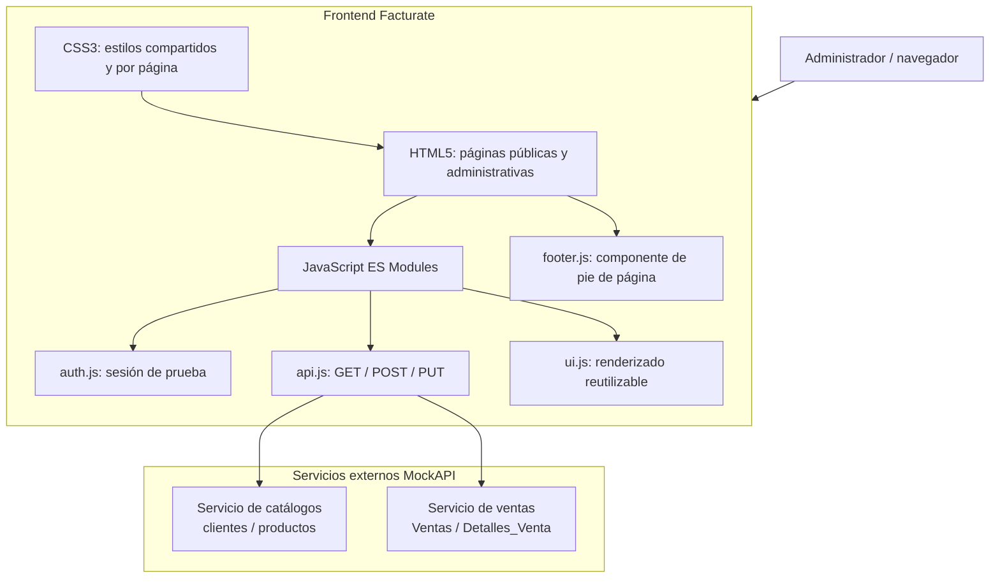
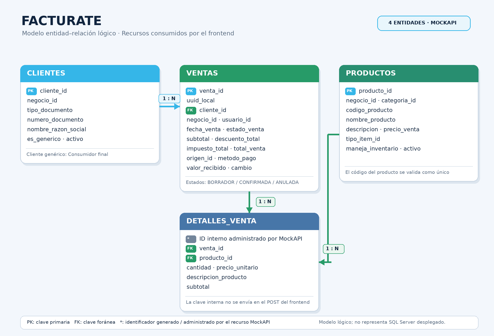

# Facturate — Sistema de gestión comercial


**Facturate** es un proyecto académico de aplicación web orientado a apoyar la gestión comercial de pequeños negocios. Su frontend permite administrar clientes y productos, preparar ventas desde un carrito, registrar el recaudo, consultar ventas recientes y revisar el historial con sus respectivos detalles.

> **Alcance de esta entrega:** frontend estático desarrollado con HTML, CSS y JavaScript Vanilla. Los datos se consultan y persisten mediante dos servicios externos de MockAPI. Este repositorio no contiene un backend propio ni una base de datos SQL Server integrada.

---

## 1. Resumen ejecutivo

Los pequeños negocios pueden llevar el registro de sus clientes, productos y operaciones comerciales mediante anotaciones manuales o herramientas dispersas. Esto dificulta consultar la información, mantener los registros actualizados y revisar las ventas realizadas.

Facturate propone una interfaz web centralizada para organizar esa información. La solución incorpora páginas públicas y un panel administrativo desde el cual se pueden consultar y mantener clientes y productos, construir un carrito, validar el recaudo y registrar una venta compuesta por una cabecera y varios detalles.

El valor del sistema en esta etapa consiste en demostrar la construcción de una aplicación frontend modular, el consumo de servicios REST, la representación dinámica de información JSON y la implementación de operaciones de acceso a datos mediante `fetch()`.

**Estado:** prototipo académico funcional. No se presenta como un sistema comercial listo para producción.

## 2. Funcionalidades

### Páginas públicas

- **Inicio (`index.html`):** presentación del proyecto.
- **Nosotros (`nosotros.html`):** información del proyecto.
- **Registro (`registro.html`):** página de registro diseñada en el frontend.
- **Inicio de sesión (`login.html`):** acceso de prueba mediante credenciales definidas en el código.

### Panel administrativo

- **Dashboard (`dashboard.html`):** consulta de catálogos, selección de cliente, búsqueda de productos, carrito, cálculo de valores, validación del recaudo, registro de ventas y visualización de ventas recientes.
- **Clientes (`clientes.html`):** consulta, creación, edición, búsqueda, filtros y activación o inactivación de clientes.
- **Productos (`productos.html`):** consulta, creación, edición, búsqueda, filtros y activación o inactivación de productos.
- **Historial (`historial.html`):** consulta de ventas, búsqueda por venta o cliente, filtros por fechas y estado, ordenamiento y visualización del detalle de cada venta.

### Flujo de venta

1. Seleccionar un cliente activo.
2. Agregar productos activos al carrito y ajustar cantidades.
3. Calcular subtotal y total. En la interfaz actual, descuentos e impuestos permanecen en cero.
4. Seleccionar el método de pago y validar el valor recibido. Para efectivo se calcula el cambio; para los demás métodos el valor recibido se iguala al total.
5. Crear la cabecera de venta inicialmente como `BORRADOR`.
6. Crear un registro en `Detalles_Venta` por cada producto del carrito.
7. Cambiar la cabecera a `CONFIRMADA` cuando todos los detalles se han registrado correctamente.
8. Si falla el registro parcial de detalles, intentar marcar la cabecera como `ANULADA`. Si el resultado de una petición es incierto, se consulta la venta usando `uuid_local` y se bloquea el reintento hasta verificarla.

El flujo usa operaciones HTTP independientes contra MockAPI; no constituye una transacción ACID de base de datos.

## 3. Arquitectura

La aplicación se ejecuta en el navegador. HTML define la estructura, CSS controla la presentación y los módulos JavaScript gestionan eventos, validaciones, estado de interfaz y comunicación HTTP. `api.js` centraliza las funciones para consultar, crear y actualizar registros.



### Organización de módulos JavaScript

| Archivo | Responsabilidad |
|---|---|
| `js/api.js` | Define los endpoints y centraliza las operaciones HTTP GET, POST y PUT. |
| `js/auth.js` | Comprueba la existencia de la sesión de prueba almacenada en `sessionStorage`. |
| `js/login.js` | Valida las credenciales de prueba y crea la sesión. |
| `js/app.js` | Gestiona Dashboard, catálogo, carrito, recaudo, persistencia de ventas y ventas recientes. |
| `js/ui.js` | Contiene funciones compartidas para representar clientes, productos, tablas e información del carrito. |
| `js/clientes.js` | Implementa la administración de clientes. |
| `js/pro.js` | Implementa la administración de productos. |
| `js/historial.js` | Consulta, filtra y presenta ventas y sus detalles. |
| `js/footer.js` | Registra y carga el componente reutilizable `facturate-footer`. |

### Patrón de comunicación

```text
Interacción del usuario
        ↓
Módulo de página (app.js, clientes.js, pro.js o historial.js)
        ↓
Función reutilizable de api.js
        ↓
Fetch API (GET / POST / PUT)
        ↓
Servicio MockAPI
        ↓
Respuesta JSON
        ↓
Actualización del estado y renderizado del DOM
```

## 4. Modelo de datos

El frontend consume cuatro recursos principales: `Clientes`, `Productos`, `Ventas` y `Detalles_Venta`. El siguiente diagrama representa las relaciones lógicas utilizadas por la aplicación; no representa una base de datos SQL Server ya desplegada.



### Entidades y campos utilizados

**Clientes**

- `cliente_id` — identificador del cliente.
- `negocio_id`
- `tipo_documento`
- `numero_documento`
- `nombre_razon_social`
- `es_generico`
- `activo`

**Productos**

- `producto_id` — identificador del producto.
- `negocio_id`
- `categoria_id`
- `codigo_producto`
- `nombre_producto`
- `descripcion`
- `precio_venta`
- `tipo_item_id`
- `maneja_inventario`
- `activo`

**Ventas**

- `venta_id` — identificador de la venta y clave utilizada para acceder al recurso individual en MockAPI.
- `uuid_local` — identificador local utilizado para ayudar a verificar operaciones inciertas.
- `negocio_id`
- `cliente_id` — referencia al cliente.
- `usuario_id`
- `fecha_venta`
- `estado_venta`
- `subtotal`
- `descuento_total`
- `impuesto_total`
- `total_venta`
- `origen_id`
- `metodo_pago`
- `valor_recibido`
- `cambio`

**Detalles_Venta**

- Identificador del recurso administrado por MockAPI.
- `venta_id` — referencia a la cabecera de venta.
- `producto_id` — referencia al producto.
- `cantidad`
- `precio_unitario`
- `descripcion_producto`
- `subtotal`

### Relaciones

- Un cliente puede estar relacionado con muchas ventas (1:N).
- Una venta puede contener muchos detalles (1:N).
- Un producto puede aparecer en muchos detalles de venta (1:N).

Los campos `negocio_id`, `usuario_id`, `origen_id`, `categoria_id` y `tipo_item_id` aparecen como referencias escalares en los datos utilizados por el frontend. Sus entidades de origen no forman parte de los cuatro recursos documentados aquí.

**Nota de alcance:** el nombre exacto de la clave primaria interna de `Detalles_Venta` lo administra la configuración del recurso MockAPI; el frontend no envía ese identificador al crear cada detalle. Debe confirmarse en el modelo físico antes de replicar esta estructura en SQL Server.

## 5. Stack tecnológico

| Tecnología / herramienta | Versión o especificación | Uso |
|---|---|---|
| HTML | HTML5 | Estructura semántica de las páginas. |
| CSS | CSS3 | Estilos, diseño responsive y componentes visuales. |
| JavaScript | JavaScript Vanilla con ES Modules | Lógica de interfaz y separación por módulos. |
| Fetch API | API nativa del navegador | Solicitudes HTTP a MockAPI. |
| Bootstrap | 5.3.8 (CDN) | Grid, formularios, utilidades y componentes como Offcanvas y Modal. |
| MockAPI | Servicio externo | Persistencia simulada de catálogos y ventas. |
| Visual Studio Code | Versión no fijada en el repositorio | Entorno de edición. |
| Live Server | Extensión de VS Code; versión no fijada | Servidor HTTP local para desarrollo. |
| Git | Versión no fijada | Control de versiones. |
| GitHub | Repositorio remoto | Colaboración y alojamiento del código. |

No se encontró un gestor de paquetes ni librerías JavaScript adicionales instaladas por npm. Bootstrap se carga desde CDN. La aplicación utiliza también APIs nativas del navegador como `sessionStorage`, `Intl.NumberFormat`, Custom Elements y `fetch()`.

## 6. Servicios MockAPI y endpoints

La comunicación está centralizada en `js/api.js` y utiliza dos servicios independientes.

| Servicio | Recurso | Método utilizado | Endpoint |
|---|---|---|---|
| Catálogos | Clientes | GET, POST, PUT | [`/clientes`](https://6adcddc5fa5e73d4ab2dc4c9.mockapi.io/api/v1/clientes) |
| Catálogos | Productos | GET, POST, PUT | [`/productos`](https://6adcddc5fa5e73d4ab2dc4c9.mockapi.io/api/v1/productos) |
| Ventas | Ventas | GET, POST, PUT | [`/Ventas`](https://6adcddc0fa5e73d4ab2dc4b1.mockapi.io/Facturate/api/Ventas) |
| Ventas | Detalles_Venta | GET, POST | [`/Detalles_Venta`](https://6adcddc0fa5e73d4ab2dc4b1.mockapi.io/Facturate/api/Detalles_Venta) |

Las URLs base están declaradas en `js/api.js`. No hay variables de entorno configuradas en el repositorio. Si se cambia de instancia o recurso MockAPI, deben actualizarse los endpoints en ese archivo.

### Funciones de acceso a datos

- `consultarAPI(url)`: realiza GET, comprueba `response.ok`, convierte el JSON y verifica que la respuesta sea un arreglo.
- `crearAPI(url, datos)`: realiza POST con `Content-Type: application/json` y devuelve el JSON creado.
- `actualizarAPI(url, datos)`: realiza PUT con `Content-Type: application/json` y devuelve el JSON actualizado.

Las funciones registran los errores en consola y los vuelven a lanzar para que cada módulo pueda presentar mensajes adecuados.

### Cobertura CRUD implementada

| Recurso | Create | Read | Update | Delete |
|---|---|---|---|---|
| Clientes | POST | GET | PUT | Baja lógica mediante PUT (`activo = false`); reactivación mediante PUT. No se usa DELETE físico. |
| Productos | POST | GET | PUT | Baja lógica mediante PUT (`activo = false`); reactivación mediante PUT. No se usa DELETE físico. |
| Ventas | POST de cabecera | GET | PUT para estados `BORRADOR`, `CONFIRMADA` o `ANULADA` | No se ofrece eliminación física desde la interfaz. |
| Detalles_Venta | POST | GET | No se ofrece edición desde la interfaz. | No se ofrece eliminación desde la interfaz. |

Por tanto, el CRUD de Clientes y Productos está implementado mediante eliminación lógica. Ventas y Detalles_Venta tienen operaciones de creación y consulta, además de actualizaciones de estado para la cabecera de venta. **No debe interpretarse que las cuatro entidades ofrecen CRUD físico completo.**

## 7. Manejo de errores y validaciones

- `try...catch` en las operaciones asíncronas.
- Verificación de respuestas HTTP mediante `response.ok`.
- Validación de que la consulta general devuelva un arreglo JSON.
- Mensajes de carga, error y confirmación en la interfaz.
- Validación de campos obligatorios y documentos duplicados en Clientes.
- Validación de códigos duplicados, categoría y precio en Productos.
- Protección del registro de cliente genérico Consumidor final.
- Validación del carrito, cliente, método de pago, valor recibido y cambio.
- Registro de la cabecera en estado `BORRADOR`, creación secuencial de detalles y confirmación posterior.
- Ante un fallo parcial de detalles, intento de actualización de la cabecera a `ANULADA`.
- Ante una respuesta incierta, búsqueda por `uuid_local` y bloqueo del reintento hasta revisar el registro.

**Límite técnico:** estas operaciones se realizan mediante varias solicitudes HTTP a MockAPI. No existe una transacción distribuida ni una garantía ACID entre cabecera y detalles. La anulación es una estrategia de compensación mediante PUT, no un `ROLLBACK` de base de datos.

## 8. Requisitos previos

- Navegador moderno con soporte para JavaScript ES Modules.
- Visual Studio Code o editor equivalente.
- Extensión Live Server (recomendada para este proyecto).
- Conexión a Internet para cargar Bootstrap desde CDN y consumir MockAPI.
- Acceso a los endpoints MockAPI definidos en `js/api.js`.

Node.js no es necesario para ejecutar la aplicación en el navegador. Puede utilizarse opcionalmente para verificar la sintaxis de los archivos JavaScript.

## 9. Configuración y ejecución local

### 9.1. Clonar el repositorio

```bash
git clone https://github.com/julianz-dev/facturate-frontend-momento_3.git
cd facturate-frontend-momento_3
```

### 9.2. Abrir el proyecto

1. Abrir la carpeta del proyecto en Visual Studio Code.
2. Instalar o habilitar la extensión **Live Server**, si todavía no está disponible.
3. Abrir `index.html`.
4. Seleccionar **Open with Live Server**.
5. Navegar desde la página inicial hacia el inicio de sesión y el panel administrativo.

También se puede abrir `login.html` directamente desde Live Server para acceder a la demostración administrativa.

No se deben abrir las páginas mediante `file://`, porque el componente de pie de página se carga con `fetch()` y los módulos ES necesitan servirse mediante HTTP.

### 9.3. Inicio de sesión de prueba

Las credenciales de demostración están definidas directamente en `js/login.js`. Para consultar o cambiar esos valores, revisar dicho archivo.

La sesión se guarda en `sessionStorage` bajo la clave `sesionActiva`. Este mecanismo es únicamente demostrativo y no equivale a autenticación segura en un servidor.

### 9.4. Variables de entorno y compilación

- **Variables de entorno:** no se utilizan ni existe un archivo `.env` en el proyecto.
- **Instalación de dependencias:** no se requiere `npm install`.
- **Compilación:** no hay proceso de build configurado.
- **Ejecución:** servir los archivos estáticos mediante Live Server u otro servidor HTTP local.

### 9.5. Verificación opcional de sintaxis

Con Node.js instalado, desde la raíz del proyecto se pueden ejecutar:

```bash
node --check js/api.js
node --check js/auth.js
node --check js/login.js
node --check js/ui.js
node --check js/app.js
node --check js/clientes.js
node --check js/pro.js
node --check js/historial.js
node --check js/footer.js
```

Esta comprobación valida sintaxis; no sustituye las pruebas funcionales en el navegador ni confirma la disponibilidad de MockAPI.

## 10. Estructura del repositorio

```text
facturate-frontend-momento_3/
├── Imagenes/
├── componentes/
│   └── footer.html
├── js/
│   ├── api.js
│   ├── app.js
│   ├── auth.js
│   ├── clientes.js
│   ├── footer.js
│   ├── historial.js
│   ├── login.js
│   ├── pro.js
│   └── ui.js
├── base.css
├── clientes.css
├── clientes.html
├── dashboard.css
├── dashboard.html
├── footer.css
├── historial.css
├── historial.html
├── index.html
├── login.css
├── login.html
├── navegacion.css
├── nosotros.css
├── nosotros.html
├── productos.css
├── productos.html
├── registro.css
├── registro.html
└── styles.css
```

## 11. Flujo de trabajo y control de versiones

El repositorio remoto está alojado en GitHub y utiliza `main` como rama principal en la copia revisada.

Se recomienda trabajar con ramas para aislar los cambios de cada integrante y actualizar la rama principal antes de iniciar una tarea.

```bash
# Actualizar la rama principal
git checkout main
git pull origin main

# Crear una rama de trabajo
git checkout -b feat/nombre-del-modulo

# Revisar los cambios
git status

# Preparar y confirmar los archivos
git add <archivos-modificados>
git commit -m "feat(modulo): descripcion del cambio"

# Publicar la rama
git push -u origin feat/nombre-del-modulo
```

Se utiliza como convención recomendada **Conventional Commits**, por ejemplo:

- `feat(clientes): agregar filtro por estado`
- `fix(dashboard): corregir actualización del catálogo`
- `refactor(frontend): organizar módulos JavaScript`
- `docs(readme): documentar arquitectura y configuración`

Antes de hacer `git add .`, revisar `git status` para evitar incluir archivos ajenos a la tarea.

## 12. Validación del estado del proyecto

En la revisión del paquete utilizado para esta documentación:

- Se identificaron nueve archivos JavaScript.
- Los nueve superaron `node --check` con Node.js `v22.16.0` en el entorno de auditoría.
- Las importaciones locales revisadas apuntan a exportaciones existentes.
- Las referencias locales a JavaScript y CSS desde las páginas HTML fueron encontradas.
- El proyecto no incluye pruebas automatizadas, configuración de CI, manifiesto `package.json` ni proceso de compilación.

La comprobación anterior es estática. La ejecución real depende del navegador, de la disponibilidad de los servicios MockAPI y de la configuración externa de Bootstrap CDN.

## 13. Seguridad y limitaciones conocidas

- El inicio de sesión utiliza credenciales de prueba escritas en `js/login.js`.
- La sesión se conserva en `sessionStorage`; no hay autenticación ni autorización en un backend propio.
- Las direcciones MockAPI están incluidas en el frontend y son visibles desde el navegador. No deben tratarse como secretos.
- MockAPI se utiliza como servicio de demostración, no como sustituto de una base de datos transaccional de producción.
- Los datos y servicios requieren conexión a Internet.
- Los campos `negocio_id`, `usuario_id`, `origen_id`, `categoria_id` y `tipo_item_id` se manejan como valores de referencia; las entidades correspondientes no están incluidas en los cuatro recursos del frontend.
- Las ventas se registran mediante varias solicitudes HTTP y usan una estrategia de compensación para los errores parciales; no existe atomicidad entre solicitudes.
- No se incluye inventario cuantitativo ni descuento/impuesto configurable en el flujo actual; en la interfaz, estos importes permanecen en cero.

## 14. Licencia y créditos

### Licencia

El repositorio revisado no contiene un archivo `LICENSE`. Por lo tanto, no se declara una licencia de código abierto ni deben suponerse permisos de reutilización, modificación o distribución fuera del alcance académico. La licencia deberá definirse explícitamente por los autores o responsables del proyecto si se requiere publicar el código con permisos de uso.

### Créditos y distribución de responsabilidades

Proyecto desarrollado en equipo como parte del programa Técnico Laboral como Asistente en Desarrollo de Software de **CESDE**.

| Integrante | Responsabilidad principal |
|---|---|
| Julián David Zapata Múnera | Desarrollo de los módulos de Clientes y Productos, además de trabajo de integración frontend. |
| Cristian Camilo Garcés Ramírez | Desarrollo del servicio de Ventas y Detalles_Venta y su participación en el flujo de venta. |

**Repositorio:** [julianz-dev/facturate-frontend-momento_3](https://github.com/julianz-dev/facturate-frontend-momento_3)

---

<p align="center">
  <strong>Facturate · Proyecto académico CESDE</strong><br>
  Frontend 1 · HTML5 · CSS3 · JavaScript · Bootstrap · MockAPI
</p>
